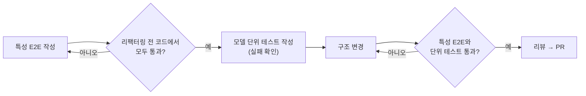
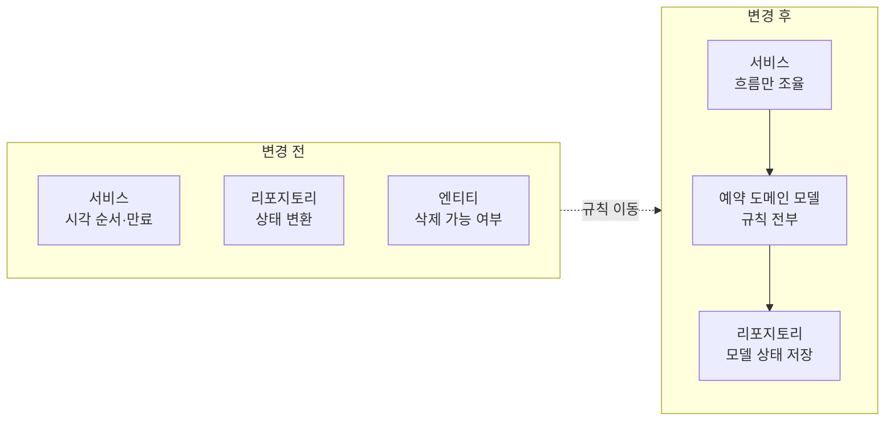

회사 API 서버(NestJS)에서 예약 도메인 리팩터링을 하고 있었다. 일부는 다른 코딩 에이전트로 먼저 진행했는데, 도메인 모델과 메서드 구조가 어색해서 결과를 그대로 믿기 어려웠다.

그래서 다른 에이전트에게 리뷰를 맡기고, 이어지는 단계는 그 에이전트와 함께 처음부터 다시 설계하기로 했다. 리팩터링이므로 기존 API 규칙과 응답 계약은 바꾸지 않는다는 원칙을 가장 먼저 정했다.

엔드포인트의 응답 모양이 바뀌면 프론트엔드와 앱이 깨진다. 프론트엔드와 상의하지 않은 응답 변경은 리팩터링으로 보지 않고 버그로 다룬다.

## 리팩터링 전에 동작부터 고정했다

응답 계약을 지키려면 "지금 어떻게 동작하는지"를 먼저 테스트로 박아 둬야 한다. 이런 테스트를 특성 테스트(characterization test)라고 부른다. 옳은지 그른지를 따지지 않고, 현재 동작을 그대로 기록한다.

첫 단계(예약 생성·삭제·상태 변경)는 테스트를 먼저 쓰는 순서로 진행했다.

1. 리팩터링 전 코드에 대해 E2E(엔드투엔드) 테스트 29개를 먼저 추가했다.
2. 리팩터링 전 코드에서 29개가 모두 통과하는 것을 확인했다.
3. 그다음에 구조를 바꿨다.

테스트를 리팩터링보다 먼저 쓴 이유는, 리팩터링한 뒤에 테스트를 쓰면 바뀐 동작을 그대로 정답으로 박아 버릴 수 있기 때문이다.

## 테스트로 드러난 정리 코드 문제

E2E를 늘리다 보니 기존 테스트의 정리 코드에도 구멍이 있었다. 테스트가 끝날 때 예약은 지우는데, 그 예약에 걸린 만료 작업은 지우지 않았다.

그 결과 로컬 DB에 이미 지워진 예약을 가리키는 만료 작업이 2,900건 쌓여 있었다. 그중 72건은 실행 시각이 지나 있어서, 스케줄러 통합 테스트가 안전장치에 걸려 시작도 못 하고 있었다.

정리 코드를 고치고, 가리키는 예약이 없는 작업만 골라 지운 뒤에야 통합 테스트를 돌릴 수 있었다.

## 흩어진 규칙을 모델로 모았다

기존 코드에서는 예약 규칙이 서비스, 리포지토리, 엔티티에 흩어져 있었다. 예약 시각 순서, 초기 상태, 만료 시각, 삭제 가능 여부, 상태 변환 같은 규칙이다.

이걸 예약 도메인 모델 하나로 옮겼다. 모델의 메서드가 내부 값을 바꾸는 역할을 맡는 구조다.

새 규칙은 테스트를 먼저 썼다. 모델 단위 테스트 49개 가운데 45개가 미구현으로 실패하는 것을 확인한 뒤 구현했다. 실패를 먼저 보는 이유는, 새로 쓴 테스트가 정말 새 동작을 검증하는지 확인하기 위해서다.

검증에서는 전체 단위 테스트 3,442개와 전체 E2E 575개, API·스케줄러 타입 검사가 모두 통과했다.

## 코드 리뷰에서 걸러진 것

리팩터링 후에는 별도 리뷰를 돌렸다. 지적 8건 중 4건을 반영했다.

- 도메인 모델이 HTTP 예외를 쓰고 있었다. 모델이 HTTP 400 예외를 잡아 도메인 오류로 바꾸는 구조였는데, 도메인 계층은 HTTP를 몰라야 한다. 공용 만료 정책에 예외를 던지지 않는 판정 함수를 추가하고, 모델은 그 판정으로 도메인 오류를 던지게 바꿨다. 시간 기준값은 정책 한 곳에만 두었다.
- 같은 상태 변환 함수가 두 군데 있어서 모델의 변환 하나로 모았다.
- 저장할 필드 목록이 중복돼 있어서 모델 상태를 그대로 저장하도록 바꿨다.
- 오류 코드 값이 중복돼 있어서 기존 값을 참조하도록 바꿨다.

## 반영하지 않은 지적과 그 이유

동시 요청에서 경쟁 상태가 생길 수 있는 지점이 두 곳 지적됐다.

둘 다 고칠 가치가 있는 문제였지만, 리팩터링 전부터 같은 동작이었다. 이번에 고치면 동작이 바뀐다.

그래서 이번 변경에서는 손대지 않고, 구현 기록 문서에 "확인된 기존 동작"으로 적어 두었다. 고칠 때는 DB 잠금보다 조건부 갱신 쪽이 맞을 것 같다는 메모도 남겼다.

리팩터링과 버그 수정을 한 PR에 섞으면, 나중에 문제가 생겼을 때 어느 쪽 때문인지 가릴 수 없다. 그래서 리팩터링 리뷰에서는 "동작은 그대로, 구조만 바꾼다"는 선을 지키는 것이 리팩터링 리뷰의 핵심이었다.

## 두 번째 단계도 같은 방식으로

다음 단계(지원 요청과 승인·거절)도 같은 순서로 진행했다.

| 단계 | 특성 E2E | 새 단위 테스트 (미구현 실패 확인) | 유지한 것 |
|---|---|---|---|
| 1단계: 생성·삭제·상태 변경 | 29개 | 49개 중 45개 실패 확인 | 응답 계약 |
| 2단계: 지원 요청·승인·거절 | 24개 | 43개 실패 확인 | 응답 계약, 잠금 순서, 오류 코드, 알림 시점 |

E2E를 만들 때 테스트가 알림 발행 경로를 그대로 타면 실제 푸시 알림이 나갈 수 있었다. 그래서 이 테스트에서는 알림 발행을 테스트 대역으로 바꿨다.

## 정리

- 리팩터링은 응답과 동작이 그대로일 때 완료된 것으로 본다. 코드가 깔끔해진 것만으로는 완료 기준을 채우지 못한다.
- 그래서 리팩터링 전에 특성 테스트로 현재 동작을 고정한다.
- 리뷰에서 실제 버그가 나와도, 동작을 바꾸는 수정이면 따로 빼고 문서에 남긴다.
- AI가 만든 리팩터링도 "이 변경으로 응답이 바뀌는가"라는 같은 기준으로 리뷰한다.