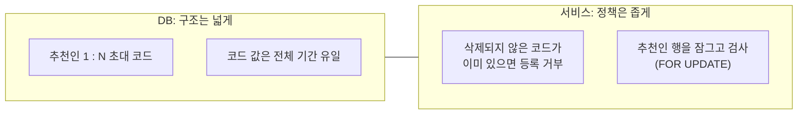
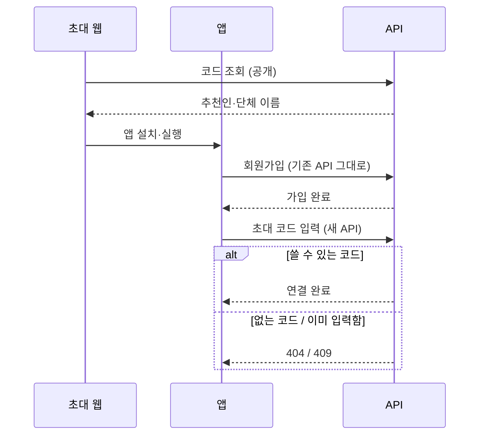

회사 서비스에 추천인 기능을 붙이게 됐다. 기존 파트너가 초대 코드를 나눠 주고, 그 코드로 들어온 회원이 생기면 나중에 수익을 나누는 구조다.

기획 문서는 초안이었고, 화면 설계와도 서로 다른 데가 많았다. 그래서 API와 DB를 먼저 설계하면서 정책 질문을 하나씩 정리했다.

이 글은 그중 초대 코드 테이블의 구조, 그리고 회원이 코드를 입력하는 API를 가입 API에 넣을지 따로 뺄지 정한 과정을 기록한다.

## 먼저 정한 네 가지

설계 전에 질문을 네 개로 줄였고, 답은 이렇게 받았다.

| 질문 | 결정 |
|---|---|
| 누가 추천인이 될 수 있나 | 승인된 파트너만 |
| 추천인 한 명이 코드를 여러 개 가질 수 있나 | DB는 허용, 로직은 하나만 |
| 코드는 누가 만드나 | 관리자가 등록할 때 서버가 생성 |
| 추천인별 수익 비율 | 이번에는 제외 |

두 번째 답 "DB는 허용하되 로직은 하나만"은 DB 구조와 서비스 로직의 허용 범위를 다르게 둔다는 뜻이다.

## DB는 열어 두고, 로직에서 막는다

지금 정책은 "추천인당 코드 하나"다. 그렇다면 DB에 유일 제약(unique)을 걸면 가장 확실하다.

그런데 기획이 초안이었다. 나중에 "단체마다 코드를 따로 주자"는 요구가 나오면, 유일 제약을 풀고 데이터를 옮기는 마이그레이션이 필요하다. 정책이 흔들리는 단계에서는 DB 구조를 좁게 잡을수록 나중이 비싸다.

테이블은 이런 모양으로 잡았다. 이름은 일반적인 이름으로 바꿔 적었다.

```sql
create table invite_codes (
  id uuid primary key default gen_random_uuid(),
  partner_id uuid not null references partners(id),  -- 추천인
  code varchar(20) not null,
  group_name varchar(100) not null,                  -- 코드를 나눠 줄 단체
  created_at timestamptz not null default now(),
  deleted_at timestamptz,
  constraint uq_invite_codes_code unique (code)
);
create index ix_invite_codes_partner_id on invite_codes (partner_id);
```

단체 이름은 추천인이 코드를 나눠 주는 대상(협회 같은 모임)을 구분하려는 값이다.

설계에서 신경 쓴 점은 세 가지다.

- 추천인 외래 키(FK)는 회원이 아니라 파트너를 가리킨다. "추천인은 승인된 파트너"라는 자격을 DB 관계로 드러내기 위해서다.
- 코드는 삭제된 것까지 포함해 전체 기간 유일하다. 삭제된 코드를 재사용하면 과거 추천 기록을 추적할 수 없다.
- "하나만" 규칙은 서비스에서 지킨다. 관리자 두 명이 동시에 등록하면 둘 다 "아직 없음"을 보고 통과할 수 있다. 그래서 같은 트랜잭션 안에서 추천인 행을 `FOR UPDATE`로 잠그고 검사한다.



## 코드 입력 API의 위치: 가입 API와 별도 API 비교

회원이 코드를 입력하는 시점도 정해야 했다. 가입 API는 이메일 가입과 소셜 가입을 한 엔드포인트에서 처리하고 있었다. 신규 회원은 반드시 이 API를 거친다.

| | 가입 API에 `inviteCode` 추가 | 초대 코드 입력 API 별도 |
|---|---|---|
| 가입 시점에만 연결 | 구조상 자동으로 보장 | 기간·횟수 규칙을 따로 둬야 함 |
| 잘못된 코드 | 가입을 실패시키거나, 조용히 무시해야 함 | 404·409로 명확히 안내 |
| 기존 코드 영향 | 오래된 가입 모듈 수정 | 가입 API는 그대로, 새 모듈 추가 |
| 나중에 입력 | 불가 | 가능 |
| 연결 누락 위험 | 없음 (가입과 한 번에 처리) | 입력 호출이 실패하면 연결이 빠짐 |

별도 API로 정한 이유는 세 가지다.

1. 초대 코드 때문에 가입이 막히면 안 된다. 수익 분배 연결은 부가 기능이므로, 핵심 흐름인 가입과 실패를 분리하는 편이 안전하다.
2. 코드는 가입 전에 사라지기 쉽다. 앱을 설치한 뒤에도 초대 링크 정보를 넘겨주는 지연 딥링크(deferred deep link)를 쓸 수 있을지 아직 확실하지 않았다. 그렇다면 사용자가 직접 입력해야 하고, 가입 직후 입력 화면이 자연스럽다.
3. 이미 만든 판정 로직을 재사용할 수 있다. 초대 웹의 공개 조회 API에서 "쓸 수 있는 코드인지" 판정하는 메서드를 그대로 쓸 수 있었다.



## 별도 API에서 다시 정해야 하는 정책

별도 API는 "가입할 때만 연결"을 구조로 보장해 주지 않는다. 그래서 입력 가능 기간, 변경 가능 여부, 자기 초대 차단, 연결 후 추천인 탈퇴 처리를 서버 정책으로 먼저 정해야 했다.

API를 나누기로 하면서, 코드 몇 줄을 고치는 일보다 이 정책 목록을 함께 정하는 일이 더 큰 작업이 됐다.

## 정리

- 정책이 초안일 때는 DB 구조를 넓게, 서비스 로직을 좁게 잡는다. 정책이 바뀌면 로직만 고치면 된다.
- 넓은 구조를 로직으로 좁힐 때는 동시성을 같이 본다. "이미 있으면 거부"는 잠금 없이는 지켜지지 않는다.
- 부가 기능을 핵심 흐름(가입)에 끼워 넣으면, 부가 기능의 실패가 핵심 흐름을 막는다.
- API를 분리하면 구조가 보장하던 규칙을 정책으로 다시 세워야 한다. 그 목록을 먼저 만든다.