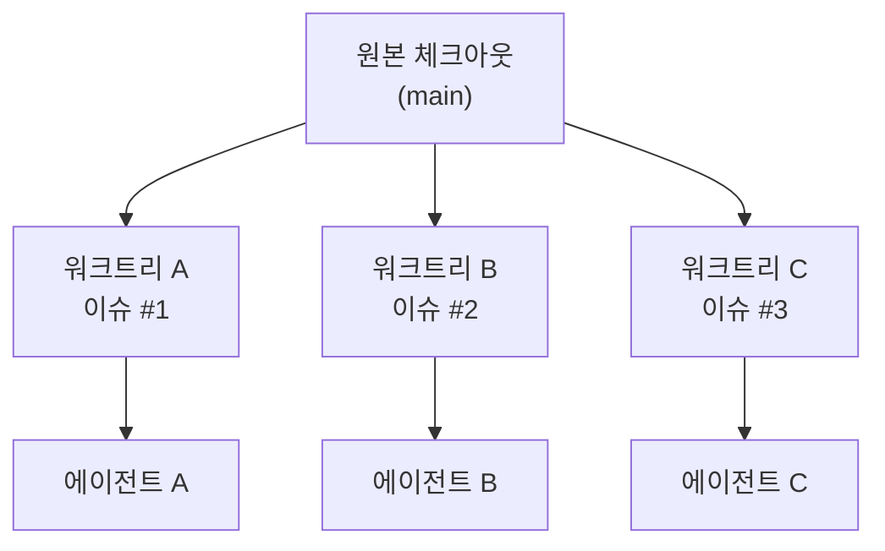
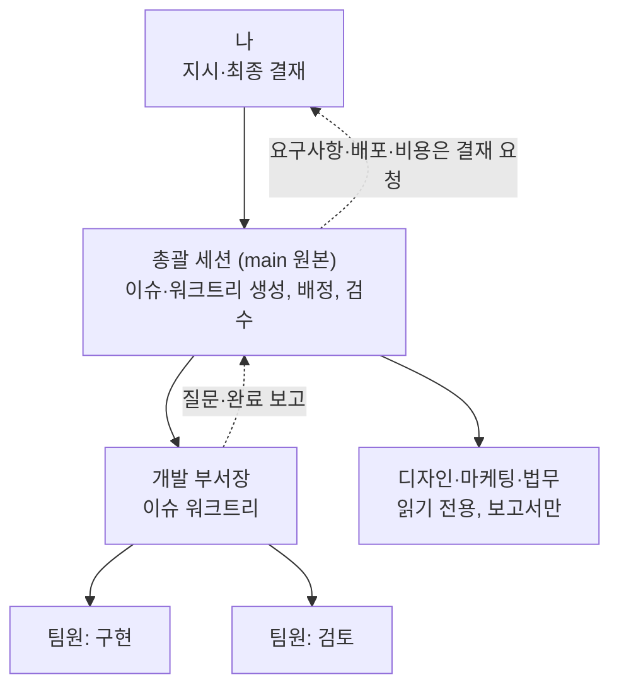

개인 프로젝트로 게임 정보 사이트를 운영하면서 할 일이 한꺼번에 늘었다. 아이템 도감, 계산기, 헤더 검색, 모바일 레이아웃 수정이 동시에 쌓였다.

코딩 에이전트 하나와 대화하며 순서대로 처리하기에는 너무 느렸다. 그래서 바라는 모양을 이렇게 정했다.

> 내가 회사 대표처럼 간단히 지시하고 결과만 확인한다. 실제 작업은 에이전트들이 나눠서 한다.

이 글은 그 구조를 실제로 시험해 본 기록이다.

## 기본 단위: 이슈 하나, 워크트리 하나

할 일 하나마다 Linear 이슈를 하나 만들고, 그 이슈에 연결된 git 워크트리 하나에서 에이전트 하나가 일한다.

같은 저장소에서 여러 에이전트가 동시에 브랜치를 바꾸면 서로의 작업 트리를 망가뜨린다. 워크트리는 브랜치마다 작업 폴더가 따로 있어서 이 문제가 없다.

워크트리와 터미널 관리는 Orca를 썼다. Orca는 워크트리마다 터미널과 브라우저 탭을 묶어 관리하고, 에이전트를 띄워 감독하는 오케스트레이션 명령을 제공한다.

## 시작 절차를 묶은 스킬

이슈 생성부터 에이전트 실행까지의 시작 절차(킥오프)를 스킬 하나로 묶었다. 스킬은 에이전트가 필요할 때 불러 읽는 절차 문서다.

1. 지시 내용을 바탕으로 Linear 이슈 초안을 만든다(프로젝트, 담당자, 라벨, 본문).
2. 내가 초안을 확인하면 이슈를 만든다.
3. 그 이슈에 연결된 Orca 워크트리를 만든다.
4. `.env` 같은 실행에 필요한 파일을 원본에서 복사한다.
5. 이슈 상태를 진행 중으로 바꾼다.
6. 새 워크트리에서 에이전트를 실행하고 작업을 넘긴다.

써 보면서 고친 점도 있었다.

- 처음에는 파일 복사를 새 에이전트에게 프롬프트로 시켰다. 그런데 에이전트가 이 지시를 빠뜨리면 `.env` 없이 작업이 시작될 수 있었다. 그래서 원본 세션이 먼저 복사하고 확인한 뒤에 에이전트를 실행하도록 순서를 바꿨다.
- 이슈를 만들기 전에 비슷한 열린 이슈가 있는지 검색하고, 있으면 초안에 "기존 이슈로 진행할지" 후보로 보여 주게 했다.
- 작업이 끝나면 PR이 병합된 것을 확인한 뒤에만 이슈를 완료로 바꾸게 했다.

## 감독 구조 시험

다음으로는 "회사처럼" 움직이는 3단 구조를 원했다. 총괄 세션이 일을 나누고, 그 아래에서 에이전트가 일하고, 그 아래에 또 에이전트가 있는 구조다.

이 글에서는 총괄 세션이 띄운 에이전트를 "작업자", 작업자가 띄운 에이전트를 "팀원"이라고 부른다.

| 확인 항목 | 결과 |
|---|---|
| 총괄이 작업자 띄우기 | 성공. 약 1분 뒤 완료 보고가 총괄에게 도착했다 |
| 작업자의 브라우저 사용 | 성공 |
| 작업자가 팀원 띄우기 | 성공. 팀원이 같은 탭의 분할 칸으로 떴고, 메시지로 결과를 보고했다 |
| 작업자가 질문을 올리고 총괄이 답하기 | 성공 |
| 작업자가 이슈와 워크트리 만들기 | 성공 |
| 작업자가 감독형 하위 작업자 띄우기 | 실패. 중첩 깊이 제한(최대 1단계)에 걸렸다 |

작업자의 보고는 그대로 믿지 않고 총괄이 다시 확인했다. 예를 들어 팀원이 보고한 사이트 이름을 총괄이 소스 파일에서 직접 대조했다.

## 시험에서 알게 된 제약 두 가지

감독형 작업자는 기본 1단계까지만 허용된다. 설정에서 깊이를 늘릴 수 있지만, 감독 계층이 깊어질수록 실패가 연쇄로 번질 위험이 커진다.

작업자가 새 실행 단위를 만들면 메시지가 끊긴다. Orca 오케스트레이션은 감독 작업 묶음을 Run이라는 단위로 관리한다. 작업자가 새 Run을 만들면 메시지를 받는 곳도 새 Run으로 바뀌어, 총괄이 보내는 후속 메시지가 작업자에게 닿지 않는다. 중첩 구조에서 가장 피해야 할 함정이었다.

## 최종 구조

설정은 그대로 두었다. Orca 오케스트레이션은 총괄과 작업자 사이 1단계에만 썼다. 작업자 아래 팀원은 Claude Code의 에이전트 팀(Agent Teams) 기능으로 띄웠다.

작업자에게는 부서를 맡겨 "부서장"이라고 불렀다. 코드 변경은 개발 부서장이 이슈 워크트리에서 맡는다. 디자인·마케팅·법무는 코드를 고치지 않고 보고서만 쓰는 읽기 전용 부서로 두었다.

운영 규칙도 시험 결과를 바탕으로 정했다.

- 감독형 작업자는 총괄만 띄운다.
- 작업자는 Run을 만들지 않는다.
- 이슈와 워크트리는 총괄만 만든다. 부서장은 필요하면 총괄에게 제안한다. 통제 지점이 한 곳이어야 이슈가 중복되거나 워크트리가 흩어지지 않는다.
- 브라우저는 한 번에 한 작업자만 쓴다.

결재 기준도 정했다. 기술 선택이나 저장소 규칙으로 답이 정해지는 질문은 총괄이 처리한다. 요구사항, 병합·배포, 비용, 설정 변경, 데이터 삭제, 외부 게시는 나에게 올라온다.

## 운영하며 달라진 점

PR 여러 개가 병렬로 올라오니 처리 속도는 확실히 빨라졌다. 대신 내 일이 "코드 작성"에서 "결과 검수"로 바뀌었다. 스크린샷을 보고 "390px에서 표가 잘린다"고 돌려보내는 일이 많아졌다.

병렬로 일하면 충돌도 병렬로 생긴다. 앞선 PR이 병합되면 다른 브랜치를 그 위로 다시 맞추고 검증을 다시 돌려야 했다. 그래서 배포 순서를 총괄이 정하고, 뒤 순서 작업은 로컬 커밋만 해 둔 채 신호를 기다리게 했다.

## 정리

- 할 일 하나에 이슈 하나, 워크트리 하나, 에이전트 하나로 나누면 에이전트끼리 작업 트리를 망가뜨리지 않는다.
- 감독 계층은 얕게 둔다. 이슈와 워크트리를 만드는 통제 지점은 총괄 한 곳이다.
- 작업자의 보고는 그대로 믿지 않고 총괄이 원본 근거로 다시 확인한다.
- 병렬로 일하면 충돌도 병렬로 생기므로, 병합 순서는 한 곳에서 정한다.