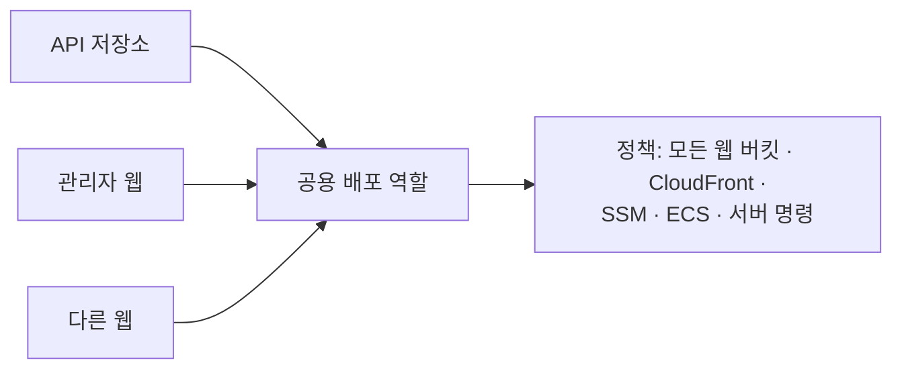
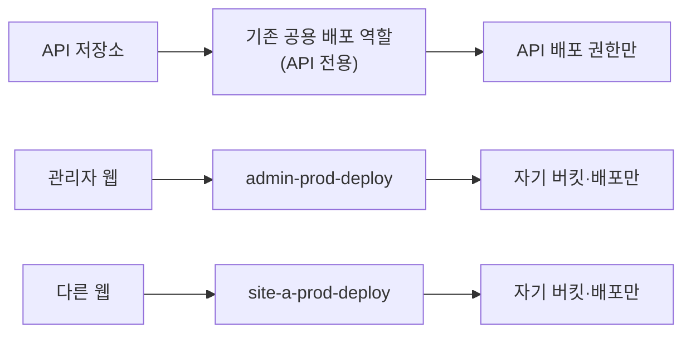

회사에 새 정적 웹(React)을 하나 추가하게 됐다. 기존 관리자 웹처럼 S3와 CloudFront로 호스팅하고, GitHub Actions에서 배포하는 구성이다. GitHub Actions가 장기 키 없이 OIDC(OpenID Connect) 토큰으로 AWS 역할을 받아 배포한다. 이미 두 번 해 본 구성이라 금방 끝날 줄 알았다.

조사해 보니 배포용 IAM 정책은 이미 5,472자였다. 정적 웹 하나에 약 1,100자가 드니, 새 웹을 넣으면 6,144자 한도를 넘는다.

## 정책이 한도에 가까워진 과정

GitHub Actions용 공용 배포 역할이 하나 있었고, 그 역할에 관리형 정책 하나가 붙어 있었다. API, 관리자 웹, 다른 정적 웹 저장소의 develop·main 브랜치가 모두 이 역할을 썼다.

정책 안에는 서비스마다 허용 규칙(Statement) 4~5개가 따로 있었다. 각 규칙은 특정 버킷, 특정 CloudFront 배포, 특정 SSM 경로만 허용했다. 최소 권한 방식이었고, 이 방향은 맞았다.

다만 웹을 하나 추가할 때마다 이 규칙 묶음을 손으로 복제해 왔다.

| 항목 | 크기 |
|---|---|
| 현재 정책 | 5,472자 |
| 새 웹을 같은 방식으로 추가하면 | 약 6,572자 |
| 관리형 정책 한도 | 6,144자 |

## IAM 관리형 정책의 한도

관리형 정책 문서 하나는 공백을 빼고 6,144자까지이며, 늘릴 수 없는 고정 한도다. 정책 버전은 최대 5개까지 보관되지만 실제로 적용되는 건 기본 버전 하나뿐이다. 나머지는 되돌리기용 이력이고 권한이 합쳐지지 않아서, 버전을 늘려도 한도는 늘지 않는다.

늘릴 수 있는 쪽은 개수다. 역할 하나에 붙일 수 있는 관리형 정책은 기본 20개, 최대 25개다.

## 넓게 열면 안 되는 이유

가장 쉬운 해결책은 `s3:*`, `cloudfront:*`를 모든 리소스에 주는 것이다. 정책이 짧아지고 다시는 한도를 걱정할 필요가 없다.

그렇게 하지 않은 이유는 프론트 워크플로 구조에 있었다. 의존성 설치와 AWS 인증이 같은 작업 안에 있었다.

npm 패키지 하나가 악성으로 바뀌면, 그 패키지의 설치 스크립트가 같은 작업 안의 자격증명을 쓸 수 있다. 권한이 넓으면 그 피해 범위에 계정의 모든 버킷이 들어간다. 사용자 업로드 버킷 같은 운영 데이터도 포함된다.

## 정책 분리의 한계

정책을 둘로 나누면 크기 한도는 피할 수 있지만 위험은 줄지 않는다.

한 역할에 붙은 정책은 그 역할을 맡을 수 있는 모든 저장소가 함께 받는다. 정책을 몇 개로 쪼개든, 관리자 웹 저장소도 API 배포 권한을 그대로 갖는다. 위험을 줄이려면 역할 자체를 나눠야 한다.



공용 배포 역할을 다시 보니 아래 위험이 있었고, 이번 작업으로 모두 해결했다.

| 위험 | 원인 | 지금 상태 |
|---|---|---|
| 프론트 저장소가 운영 서버에 셸 명령을 보낼 수 있다 | 같은 역할에 서버 명령 실행 권한이 있었다 | 해결: 프론트 저장소를 공용 역할에서 뺐다 |
| 프론트 저장소가 운영 API 환경값을 읽을 수 있다 | 같은 역할에 API 런타임 파라미터 읽기 권한이 있었다 | 해결: 프론트 저장소를 공용 역할에서 뺐다 |
| 웹 하나가 뚫리면 다른 웹의 JS를 바꿔칠 수 있다 | 같은 역할에 모든 웹 버킷 쓰기 권한이 있었다 | 해결: 웹마다 자기 버킷만 쓰는 역할로 나눴다 |

마지막 위험은 관리자 세션 탈취로도 이어질 수 있었다. 다른 웹이 뚫리면 관리자 웹의 JS까지 바꿔치기할 수 있었기 때문이다.

## 역할 분리와 목록 기반 생성

역할을 나누는 단위로 업무별(정적 웹 / 서버), 환경별(개발 / 운영), 저장소 × 환경별을 비교했다. 쪼갤수록 막히는 위험이 늘지만 역할 수도 늘어난다.

혼자 인프라를 관리하는 입장이라 처음에는 역할 개수를 걱정했다. 따져 보니 관리 부담은 역할 개수와는 별 상관이 없었고, 손으로 따로 쓰는 코드가 몇 벌인지에 따라 달라졌다.

| 방식 | 사이트 하나 추가할 때 | 권한 하나 바꿀 때 |
|---|---|---|
| 기존 (공용 역할 + 손으로 복제한 규칙) | 규칙 4~5개 복사·수정, 크기 한도 신경 | 사이트마다 따로 수정 |
| 역할을 사이트마다 손으로 작성 | 역할·정책·신뢰 조건 새로 작성 | 여러 곳 수정 |
| 역할을 목록 하나로 생성 | 목록에 한 줄 추가 | 템플릿 한 곳만 수정 |



그래서 정적 웹은 Terraform 맵 하나로 정의했다. 맵 한 줄이 S3, CloudFront, 인증서, DNS, 배포 역할을 함께 만든다.

```hcl
static_web_sites = {
  site-a-dev  = { repo = "site-a-web", branch = "develop", domain = "dev.example.com", api_proxy = true }
  site-a-prod = { repo = "site-a-web", branch = "main",    domain = "www.example.com", api_proxy = true }
}
```

- 역할 이름은 `<사이트>-<환경>-deploy` 규칙으로 정했다. 워크플로에 넣을 역할 주소(ARN)를 예측할 수 있다.
- 접근 거부가 나면 AWS 감사 로그(CloudTrail)에 역할 이름이 남아서 어느 저장소 문제인지 바로 보인다. 공용 역할일 때는 구분이 안 됐다.
- Terraform 모듈은 만들지 않았다. 저장소에 모듈이 없었고, 파일 하나 안의 `for_each`로 충분했다. 혼자 관리할 때 모듈은 들여다볼 곳만 늘린다.

이 방식에도 단점이 있다. 템플릿을 고치면 모든 사이트에 동시에 반영되므로, 편한 만큼 실수의 영향도 전체로 간다. 그래서 `terraform plan`을 반드시 확인하는 절차를 유지했다.

## 공용 정책 정리

정적 웹들이 모두 전용 역할로 옮겨 간 뒤 공용 정책을 정리했다.

- 정적 웹 관련 허용 규칙 13개와 관련 암호화 키(KMS) 규칙 3개를 지웠다.
- 공용 역할의 신뢰 조건에서 프론트 저장소를 빼고 API 저장소만 남겼다.
- 정책 크기는 5,472자에서 2,630자로 줄었다.

지우기 전에 API 워크플로가 지우는 권한을 쓰지 않는다는 것을 확인했다. CloudTrail에서도 전환 이후 프론트 저장소가 전용 역할만 썼다는 것을 확인했다.

새 웹의 API 호출은 CloudFront의 `/api/*` 경로를 API로 프록시하는 방식으로 통일했다. 같은 출처가 되니 CORS 허용 목록을 관리할 필요가 없다. 다만 API가 받는 접속 IP가 CloudFront IP로 바뀌므로, 실제 사용자 IP는 `X-Forwarded-For` 헤더에서 읽어야 한다.

## 정리

- IAM 관리형 정책 6,144자는 늘릴 수 없는 한도이고, 버전을 늘려도 한도는 그대로다.
- 한도를 피하려고 권한을 넓히면, 공급망 공격 한 번에 운영 데이터가 날아갈 수 있다.
- 정책을 나누면 크기 문제만 해결된다. 위험을 줄이려면 역할을 나눠야 한다.
- 관리 부담은 역할 수와 별 상관이 없고, 손으로 복제하는 코드가 몇 벌인지에서 생긴다. 목록 하나에서 역할을 생성하면 역할이 늘어도 관리할 곳은 하나다.