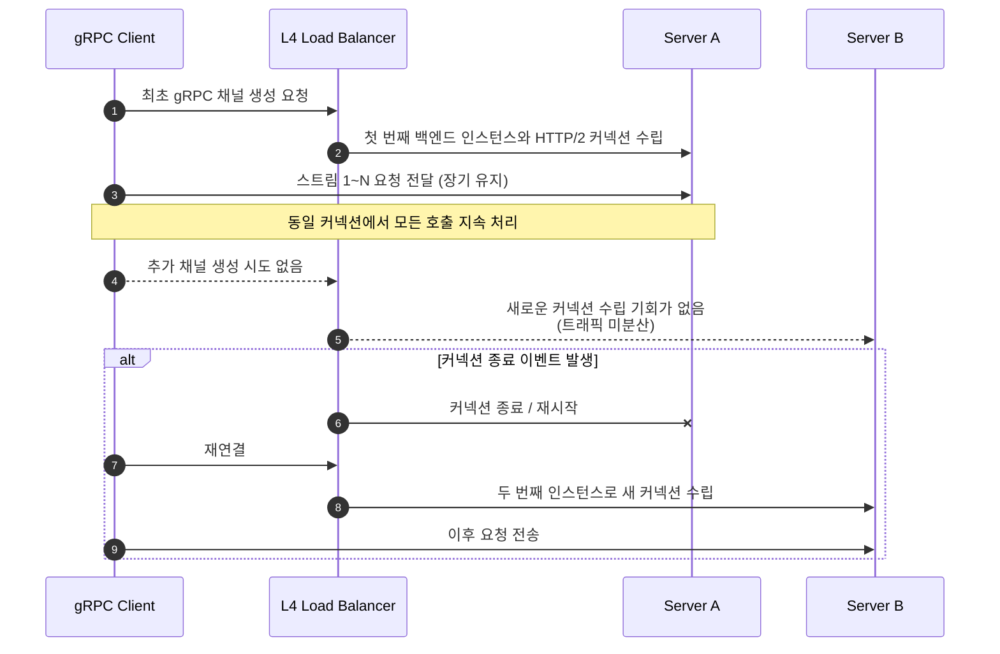
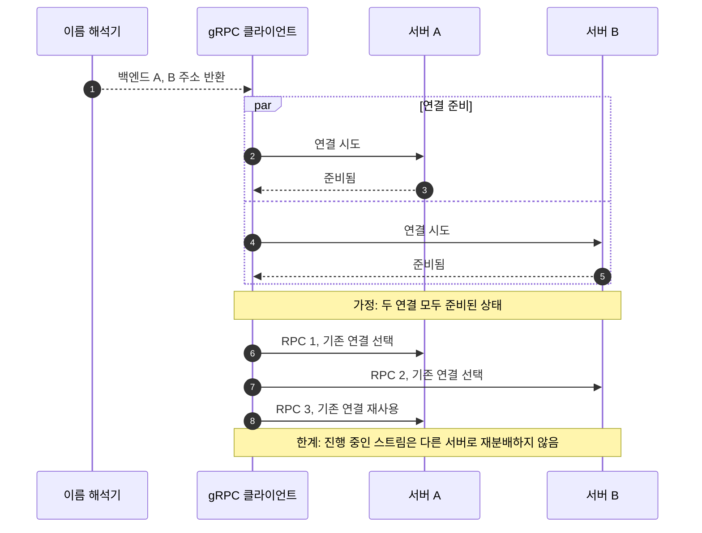

이 글은 당시 장애와 조치를 남긴 기록이다. 아래 관찰 결과와 일반적인 gRPC 동작 설명은 구분해서 읽어야 한다.

이번 수정에서는 공식 문서로 정책의 의미를 확인했다. 과거 로그나 CloudWatch 원본 지표를 다시 확보해 재측정하지는 않았다.

파트너스 앱 사용자가 앱을 사용할 수 없다는 이슈를 보고했다.

## 현상

gRPC 트래픽이 특정 서버로 편향되어 해당 서버의 CPU 사용률이 높아졌다.
2개의 인스턴스 중 1개의 인스턴스에서만 CPU 사용률이 높았다.

## 작업 내용

1. gRPC 트래픽이 편향된 서버의 인스턴스를 종료했다.
2. 채널 옵션에 gRPC 라운드 로빈 분산 설정을 적용했다. `src/config/grpc/grpc.config.service.ts`에 `loadBalancingConfig: [{ round_robin: {} }]`를 넣고 `dns:///` 스킴을 쓰도록 했다.

## 원인 분석

### 개발환경 테스트 결과

'출조일정', '출조예약', '출조이력' 등 Nest.js 모듈에서 gRPC 트래픽이 일정 시간 동안 특정 서버로 편향됐다.
일정 시간 이후에는 트래픽이 다른 서버로 바뀌기도 했지만, 같은 서버로 전송되기도 했다.

### gRPC 트래픽 편향 원인

HTTP/2는 한 연결에서 여러 스트림을 처리할 수 있다. L4 로드밸런서가 연결 단위로 분산하는 구성에서 클라이언트가 연결을 오래 재사용하면, 그 연결이 향한 백엔드에 여러 RPC가 집중될 수 있다.

gRPC 채널은 연결을 여러 개 가질 수도 있다. 위 설명은 연결 하나를 오래 재사용하는 경우에 해당한다.

당시에는 이 구조를 편향의 원인으로 분석했다. 다만 CPU 차이만으로는 연결 고착을 확정할 수 없다. 이름 해석 결과, 선택된 정책, 서버별 RPC와 연결 상태를 함께 봐야 한다. 주기적인 재시작이나 채널 재생성도 꼭 필요한 해결책은 아니다.

아래는 L4 뒤의 연결이 한 서버에 유지되는 예시다. 재연결 후 다른 서버로 갈 수도 있지만 같은 서버가 다시 선택될 수도 있다.



### gRPC `pick_first` 기본 정책 설명

[공식 로드밸런싱 설명](https://grpc.io/docs/guides/custom-load-balancing/)에 따르면 기본 정책은 `pick_first`다.

`pick_first`는 이름 해석기가 준 주소들을 시도해 연결에 성공한 첫 대상을 사용한다. 그래서 DNS 목록의 첫 항목이 늘 선택되지는 않는다. 한 연결을 오래 재사용하는 상황에서는 특정 백엔드로 호출이 집중될 수 있다.

### gRPC `round_robin` 동작 방식 정리

`round_robin`은 이름 해석 결과의 대상들에 연결을 시도하고, 연결이 준비된 백엔드를 새 RPC마다 돌아가며 고른다. 연결은 호출마다 새로 만들지 않고 준비된 연결을 재사용한다. 한 대상이 준비되지 않았거나 실패했다면 두 서버의 호출 수가 정확히 같아지지 않을 수 있다.

[서비스 설정 공식 문서](https://grpc.io/docs/guides/service-config/)에 나온 JSON 형식으로 정책을 지정한다. NestJS에서 이 설정을 전달하는 위치는 사용하는 gRPC 라이브러리와 버전의 옵션에서 확인해야 한다.

```json
{
  "loadBalancingConfig": [{ "round_robin": {} }]
}
```

아래 도표는 이름 해석으로 두 백엔드 주소를 얻고, 두 연결이 모두 준비된 경우다. 여기서는 L4 로드밸런서가 아니라 클라이언트가 RPC마다 대상을 고른다.



`dns:///`는 대상을 DNS로 해석하도록 지정하는 표기다. 로드밸런서 뒤의 인스턴스를 자동으로 찾아 주지는 않는다. 그래서 클라이언트가 실제로 어떤 주소 목록을 받는지부터 확인해야 한다. 로드밸런서 주소만 받는 구성이라면 정책 이름을 바꾼 것만으로 뒤의 인스턴스에 호출이 균등하게 나뉜다고 단정할 수 없다.

[gRPC 성능 문서](https://grpc.io/docs/guides/performance/)에 따르면 스트리밍 RPC는 시작된 뒤 다른 서버로 분산되지 않는다. 호출 개수가 비슷해도 RPC마다 처리 비용이나 스트림 수명이 다르면 CPU 사용률은 달라질 수 있다.

### keepalive 동작 구조

연결 확인(keepalive)은 HTTP/2 PING으로 연결 상태를 확인하는 기능이다. 호출 분산이나 서비스 자체의 정상 동작 확인을 대신하지는 않는다.

실제로 PING을 보내는지는 설정된 주기와 서버가 허용하는 정책에 따라 달라진다. 진행 중인 호출이 없을 때도 PING을 허용하는지도 영향을 준다.

`keepaliveTimeMs`라는 옵션 이름도 모든 gRPC 구현에서 공통으로 지원되는지 따로 확인해야 한다.

[공식 keepalive 문서](https://grpc.io/docs/guides/keepalive/)는 서버와 설정을 조율해야 한다고 설명한다. 과도한 PING은 `GOAWAY`와 `too_many_pings`로 거부될 수 있다.

PING 응답 실패로 연결을 닫으면 진행 중인 RPC가 실패할 수 있다. 재연결과 재시도는 별도 정책이다. 따라서 keepalive를 켠다고 모든 연결이 유지되거나 다음 호출이 반드시 다른 서버로 간다는 보장은 없다.

### 당시 기록에 남긴 개선 후 검증 결과

아래 날짜와 수치는 기존 글에 기록한 관찰값으로, 이번 수정에서 새로 측정하지 않았다.

테스트 요청·환경 설정·원시 로그는 이 글에 첨부하지 못했다. 그래서 독자가 같은 조건으로 재현할 수 있는 성능 자료는 아니다.

- 2025년 10월 10일 테스트에서, 수정된 gRPC 클라이언트 설정으로 호출하면 두 백엔드 인스턴스에 요청이 번갈아 분산됐다. 로컬 환경과 개발 환경에서 모두 확인했다.
- 기존 세션이 특정 인스턴스에 고착되지 않았다. 호출을 10회 이상 반복하면 응답 비율이 5:5에 가깝게 유지됐다.
- CPU 사용률 모니터링(CloudWatch)에서도 두 인스턴스의 CPU 사용률이 모두 20% 내외로 고르게 나뉘었다. 이전처럼 한쪽만 급격히 오르는 현상은 재현되지 않았다.
- 당시 gRPC 로그 확인 결과로, 연결을 재활용하는 관찰 구간에서도 특정 인스턴스 편중이 재현되지 않았다고 기록했다. 다만 모든 장기 세션에서 편중이 없다고 보장할 수는 없다.

## 같은 문제를 만났을 때 남길 근거

다시 진단한다면 응답 비율만 보지 않고 표의 항목을 같은 시간 구간으로 맞춰 기록하겠다.

| 확인 대상 | 구분하려는 원인 |
| --- | --- |
| 클라이언트 라이브러리·버전, 적용된 정책 | 설정이 실제 채널에 전달됐는가 |
| DNS 해석 결과와 준비된 연결 수 | 인스턴스 주소를 얻었는가, 한 대상만 연결 가능한가 |
| 서버별 RPC 개수·메서드·지연 | 호출 편향인가, 같은 호출 수에 다른 처리 비용인가 |
| 단일 응답 RPC와 스트리밍 RPC의 비중 | 오래 열린 스트림이 부하를 유지하는가 |
| 재시도·연결 실패·GOAWAY 기록 | 장애나 keepalive 정책이 분산 관찰을 왜곡했는가 |

설정 변경 전후에 같은 호출 종류와 관찰 시간을 써야 비교할 수 있다. 이번 수정에서 새 부하 실험이나 운영 모니터링을 하지는 않았다.

2026-09-14 보완: 공식 연결·분산·keepalive 동작을 정정하고 당시 관측값의 한계를 명시했다.
