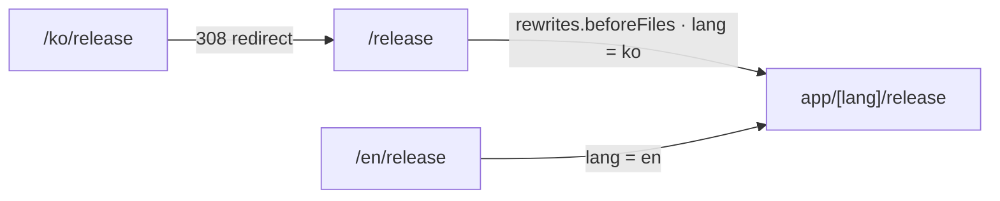

출시 예정인 게임의 정보 사이트를 만들고 있었다. 처음에는 한국어만 있었는데, 개발사가 영어·일본어 채널을 열면서 해외 방문자를 받을 준비가 필요해졌다.

지켜야 할 조건은 이미 검색에 잡힌 한국어 주소(`/`, `/release`, `/about`, `/faq`)를 바꾸지 않는 것이었다.

영어와 일본어는 `/en/...`, `/ja/...`로 붙인다. 한국어만 접두사가 없는 구조다.

이 글은 Next.js 16 App Router에서 이 구조를 만들면서 정한 것들의 기록이다.

## 주소 구조: 페이지는 한 벌, 연결은 설정에서

선택지는 두 가지였다.

| 방식 | 구조 | 특징 |
|---|---|---|
| 라우트 그룹(route group) 분리 | 한국어용 레이아웃과 영어·일본어용 레이아웃을 따로 둔다 | 설정이 없지만 루트 레이아웃이 2개 |
| 단일 `app/[lang]` | 모든 페이지를 `[lang]` 아래에 두고, 한국어 주소는 rewrites로 연결 | 루트 레이아웃 1개, 설정 몇 줄 |

검색엔진 입장에서는 두 방식이 같다. 받는 주소, HTML, hreflang, 사이트맵이 모두 같기 때문이다. 서버 안의 파일 구조는 밖에서 보이지 않는다.

두 방식의 차이는 운영에서 나타났다. 광고 스크립트, 분석 도구, 검색엔진 소유 확인 태그는 보통 루트 레이아웃에 한 번 넣는다.

라우트 그룹 방식은 루트 레이아웃이 두 개라서 태그를 바꿀 때마다 두 곳을 맞춰야 한다. 그러다 보면 한쪽을 빠뜨리기 쉬워서 단일 `app/[lang]` 구조로 정했다.

## 한국어 주소는 rewrites, `/ko`는 redirect

한국어 주소와 다른 언어 주소는 같은 페이지 파일로 연결되고, `/ko`로 시작하는 주소는 한국어 주소로 이동한다.



설정 파일에는 rewrites와 redirects를 함께 넣었다.

```ts
// next.config.ts (요약)
async rewrites() {
  return {
    // 한국어 기존 주소(/release)를 내부적으로 /ko/release로 보여 준다
    beforeFiles: PAGE_PATHS.map((path) => ({
      source: path,
      destination: internalPath(DEFAULT_LOCALE, path),
    })),
  };
},
async redirects() {
  return [
    // /ko는 따로 둔다. /ko/:path*로 함께 받으면 이동 주소가 빈 값이 된다
    { source: "/ko", destination: "/", permanent: true },
    { source: "/ko/:path*", destination: "/:path*", permanent: true },
  ];
},
```

- 한국어 주소는 `rewrites.beforeFiles`로 `/ko/...` 페이지에 연결한다. 요청마다 실행되는 Proxy(미들웨어) 대신 라우팅 규칙으로 처리해서, 빌드 때 만든 정적 페이지가 그대로 나간다.
- 같은 내용이 `/release`와 `/ko/release` 두 주소로 색인되면 안 된다. 그래서 `/ko/...`로 들어오면 308(영구 이동)로 원래 주소에 보낸다.
- redirects가 rewrites보다 먼저 검사되므로 서로 순환하지 않는다.
- `/ko` 규칙을 하나로 합치자는 리뷰 의견도 있었다. 적용해 보니 `/ko`의 이동 주소가 빈 값이 되어 되돌렸다. 로컬 `next start`로 직접 확인한 결과다.

언어마다 페이지 4종, 세 언어를 합쳐 12개 페이지를 빌드 때 정적 생성했다.

## 문구 사전은 타입으로 누락을 막는다

[Next.js 공식 국제화 가이드](https://nextjs.org/docs/app/guides/internationalization)처럼 언어별 사전 파일을 두었다. 다만 JSON 대신 TypeScript로 쓰고, 한국어 사전을 기준 타입으로 삼았다.

```ts
// dictionaries/en.ts
import type { Dictionary } from "./ko";

export default {
  nav: { release: "Release", faq: "FAQ" },
  // ...
} satisfies Dictionary;
```

영어나 일본어 사전에서 키가 하나라도 빠지면 타입 검사에서 걸린다. 그래서 번역 누락이 배포 후에 화면에서 발견되는 일을 막을 수 있다.

데이터 파일(출시 일정, FAQ)에는 언어와 무관한 id, 날짜, 상태, 출처만 남기고, 문장은 전부 사전으로 옮겼다. 날짜·상태·출처 같은 값을 언어마다 따로 적지 않으려는 구조다.

## 게임 용어는 공식 표기를 따랐다

번역에서 가장 신경 쓴 건 게임 용어였다. 개발사 디스코드의 영어·일본어 개발자 노트에서 공식 표기를 찾아 맞췄다.

일본어 "얼리 액세스"는 상점 화면이 早期アクセス로 쓰지만, 개발사 공지는 アーリーアクセス였다. 화면에는 공지 표기를 쓰고, 상점 표기는 검색어 메타데이터에만 남겼다. 사람들이 검색할 단어와 공식 표기가 다를 수 있기 때문이다.

## 검색엔진에 언어별 주소를 알린다

언어마다 언어·주소 정보를 넣었다.

- 대표 주소(canonical): 언어별 주소
- hreflang(같은 내용의 다른 언어 주소를 검색엔진에 알리는 표시): ko, en, ja와 한국어를 가리키는 `x-default`
- `og:locale`: `ko_KR`, `en_US`, `ja_JP`
- 사이트맵: 12개 주소 각각에 언어별 대체 주소

배포 후 실제 사이트에 요청해 확인했다. 언어별 주소는 200을 돌려주고 페이지마다 hreflang이 나왔다. `/ko`는 `/`로 308 이동했다.

## 404 화면이 비어 나왔다

마지막에 막힌 곳은 404였다. 없는 언어 주소(`/xx`)로 들어오면 사이트 디자인 없이 빈 오류 문서가 나왔다.

루트 레이아웃이 `app/[lang]` 아래에 있어서, 어느 경로에도 맞지 않는 주소는 실험 기능인 `global-not-found`가 그린다. 그런데 `/xx`는 `[lang]` 세그먼트에 맞아 버린다. 이 경우 루트 레이아웃의 `notFound()`가 디자인 없는 빈 오류 문서를 냈다.

그래서 `rewrites.afterFiles`로 ko·en·ja가 아닌 첫 경로를 "어느 페이지에도 맞지 않는 주소"로 보냈다.

```ts
afterFiles: [
  {
    source: `/:lang((?!(?:${LOCALES.join("|")}|_next|_vercel)(?:/|$))[^/]+)`,
    destination: "/:lang/__not-found__",
  },
],
```

afterFiles는 정적 파일과 고정 경로 다음, 동적 경로(`[lang]`) 전에 검사된다. `_next`, `_vercel` 같은 예약 경로는 건드리지 않게 제외했다. 그래서 밑줄로 시작하는 다른 주소(`/_foo`)도 404가 되는지 따로 확인했다.

| 요청 | 결과 |
|---|---|
| `/release/foo` (없는 페이지) | 404 화면 |
| `/xx` (없는 언어) | 404 화면 |
| `/_foo` (밑줄로 시작하는 주소) | 404 화면 |

지금은 세 경우 모두 사이트 디자인의 404 화면과 404 상태 코드를 돌려준다.

## 정리

- 기존 주소를 지키면서 다국어를 붙일 때는, 페이지는 `app/[lang]` 한 벌로 두고 주소 연결은 설정(rewrites, redirects)에서 한다.
- 같은 내용이 두 주소로 색인되지 않게 `/ko/...`는 기존 주소로 308을 보낸다.
- 사전을 TypeScript로 쓰고 `satisfies`로 묶으면 번역 누락이 빌드에서 걸린다.
- 번역 용어는 공식 공지 표기를 따르고, 사람들이 검색할 다른 표기는 메타데이터에 남긴다.
- 다국어 404는 `global-not-found`만으로 부족할 수 있다. 없는 언어 주소를 따로 처리해야 한다.