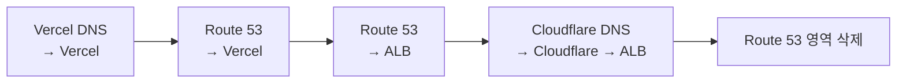
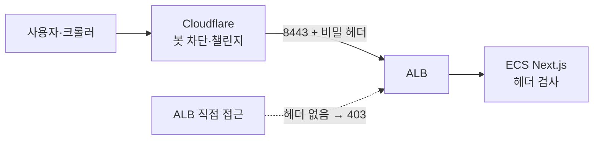

예전에 [Vercel·Supabase로 PR마다 웹과 DB를 나누는 구조](https://mion-space.dev/posts/awseseo-jikjeop-mandeuldeon-teseuteu-hwangyeongi-pr-hanaro-saenggyeossda)는 글을 쓴 적이 있다. 이번에는 반대 방향이다. 회사에서 운영하던 Next.js 서비스 하나를 Vercel에서 AWS로 옮겼다.

계기는 봇 대응이었다. 공개 API 몇 개에 호출 제한을 넣고 봇을 막아야 했다. 그런데 Vercel 공식 문서는 Vercel 앞에 다른 프록시를 두는 구성을 권장하지 않는다.

회사의 다른 서비스는 이미 AWS ECS에서 돌고 있었다. 그래서 이참에 Vercel 의존성을 없애고 운영 방식을 하나로 맞추기로 했다.

## 먼저 Vercel에 묶인 부분을 찾았다

옮기기 전에 저장소에서 Vercel 전용 기능을 찾아봤는데, 묶인 부분이 예상보다 적었다.

- `@vercel/*` 패키지가 없었다.
- Edge 런타임을 쓰는 곳이 없었다.
- OG 이미지는 `next/og`를 쓰고 있었는데, 이건 Vercel 전용이 아니라 Node 서버에서도 동작한다.
- Redis는 Upstash 클라이언트를 쓰고 있었다.

손봐야 할 것은 네 가지였다.

- 도메인 하드코딩: `*.vercel.app` 주소가 코드 여러 곳에 박혀 있어서 환경변수 하나로 모았다.
- 외부 연동의 허용 주소: 리퍼러(Referer)로 인증하는 외부 API가 있어서 새 도메인을 그쪽 콘솔에 등록해야 했다.
- 환경변수 약 25개: 값은 보지 않고 이름만 옮겼다. 비밀값은 AWS Systems Manager 파라미터 스토어(SSM)에 넣었다.
- 클라이언트 IP 읽기: `x-forwarded-for`를 읽는 코드가 있었다. 로드밸런서 뒤로 가면 헤더 구성이 달라질 수 있어 따로 검증이 필요했다.

## ECS를 고른 이유

| 선택지 | Next.js 공식 지원 범위 | 기존 운영 방식과의 일치 |
|---|---|---|
| ECS(Fargate) + Docker | 공식 배포 문서가 Node 서버·Docker 배포에서 모든 기능을 지원한다고 적음 | 다른 서비스가 이미 ECS |
| Amplify Hosting | 같은 문서가 Next.js 팀이 검증하지 않은 자체 통합으로 분류 | 새로 도입 |

처음 구성하는 입장에서는 공식 지원 범위 안에 있는 쪽이 안전하다고 보고 ECS로 정했다.

배포 구성은 `standalone` 빌드에서 시작했다.

```ts
// next.config.ts
const nextConfig = {
  output: "standalone",
};
```

- `output: "standalone"`으로 실행에 필요한 파일만 모아 Docker 이미지를 만들었다.
- 기존 ECS 클러스터에 서비스를 하나 추가했다.
- 기존 로드밸런서(ALB)에 호스트 이름 규칙과 인증서를 추가했다.
- Upstash 대신 기존 AWS Redis를 TCP 클라이언트(`ioredis`)로 쓰고, 키에 서비스 접두사를 붙였다.
- 인프라 변경은 Terraform PR로 했다. 이미지 배포는 GitHub Actions가 장기 키 없이 AWS 역할을 받는 OIDC 인증으로 했다.

기존 ALB와 Redis를 같이 쓰면 이 서비스에 요청이 폭주할 때 다른 서비스에도 영향을 줄 수 있다. 그래서 호출 제한과 키 접두사로 영향을 줄였다.

## DNS는 두 번 옮겼다

도메인 DNS는 Vercel DNS에 있었다. Vercel 의존을 모두 없애는 게 목표였다. Route 53에서는 ALB를 별칭(Alias) 레코드로 바로 가리키고 Terraform으로 관리할 수 있었다. 그래서 먼저 Route 53으로 옮겼다.

순서는 서비스 중단이 없도록 잡았다.

1. Route 53에 같은 레코드를 복사한다(아직 Vercel을 가리킨다).
2. 도메인 등록 업체에서 네임서버를 바꾼다.
3. 안정화를 확인한 뒤 A 레코드를 ALB로 바꾼다.



네임서버를 바꾸는 시점에는 레코드가 여전히 같은 곳(Vercel)을 가리키므로 중단이 없다. 실제 전환은 그 뒤에 레코드 한 줄을 바꾸는 작업이다.

이후 봇 차단을 위해 Cloudflare를 앞에 세우면서 DNS를 다시 Cloudflare로 옮겼다. 마지막에는 Route 53 영역을 지웠다. 인증서(ACM)의 DNS 검증 레코드가 Route 53 쪽 Terraform에 묶여 있어서 그 의존부터 정리했다.

- 검증 CNAME 2개를 Cloudflare에 미리 복제했다.
- 공개 리졸버에서 Route 53과 같은 값이 나오는 것을 확인했다.
- 인증서를 발급할 수 있는 기관을 정하는 CAA 레코드에 amazon.com이 있는지 확인했다.
- Terraform에서 검증 리소스를 빼고, 리스너가 인증서를 직접 참조하게 바꿨다.

이제 인증서 자동 갱신은 Cloudflare에 있는 검증 CNAME 2개에 의존한다. 나중에 누군가 "안 쓰는 레코드"로 보고 지우면 인증서 갱신이 실패한다. 그래서 이 사실을 Terraform 주석과 PR 본문에 남겼다.

## Cloudflare를 우회하지 못하게 막았다

Cloudflare를 앞에 세워도, ALB 주소로 직접 들어오면 봇 차단을 피할 수 있다. 그래서 원본 서버(오리진)를 잠갔다.



- Cloudflare가 오리진으로 보낼 때 비밀 헤더를 붙인다.
- 앱은 이 헤더가 없으면 403을 돌려준다. 단, 상태 확인(`/api/health`)은 예외다.
- 처음에는 검사만 하고 막지 않는 모드로 배포했다. 실제 브라우저 요청이 헤더를 달고 앱까지 오는 것을 확인한 뒤 강제 모드로 바꿨다.
- 마지막으로 Cloudflare가 오리진에 별도 포트(8443)로 연결하게 하고, 443의 해당 호스트 규칙을 지웠다.

적용 후 경로별 응답을 확인했다.

| 경로 | 결과 |
|---|---|
| 브라우저 → Cloudflare → 오리진 | 페이지와 API 모두 200 |
| ALB 주소로 헤더 없이 직접 접속 | 403 |
| 8443 포트로 외부에서 직접 접속 | 시간 초과 |

## 봇 차단이 구글봇까지 막고 있었다

며칠 뒤 Cloudflare 로그에서 실제 구글봇이 "AI 학습 크롤러 차단" 규칙에 걸리고 있는 것을 발견했다.

요청을 다시 세어 보니 3일 동안 구글봇의 페이지 요청 6건이 전부 403이었다. 통과한 것은 `/robots.txt`와 `/favicon.ico`뿐이었다.

원인은 "Block" 설정이 막는 범위에 있었다. Cloudflare AI Crawl Control 화면의 학습 정책을 "Block"으로 두면 검색과 학습을 겸하는 크롤러까지 함께 막는다. 구글봇과 빙봇은 화면에서 개별 스위치가 잠겨 있어 따로 풀 수도 없었다.

Cloudflare 공식 블로그가 안내하는 대로 학습 정책을 "Disallow"로 바꿨다.

| 크롤러 | Block일 때 | Disallow로 바꾼 뒤 |
|---|---|---|
| 구글봇·빙봇 (검색 겸용) | 페이지 요청 차단 | 검색용으로 허용 |
| 학습 전용 크롤러 | 차단 | 차단 |
| AI 크롤러를 사칭한 요청 | 차단 | 차단 (변경 후 직접 확인) |

설정이 저장된 것과 사칭 요청이 계속 막히는 것은 확인했다. 실제 구글봇이 이제 200을 받는지는 구글봇이 다시 와야 알 수 있다. 이 글을 쓰는 시점에는 아직 확인하지 못했다.

같은 기간 로그에서 차단된 요청은 거의 전부 클라우드 서버에서 온 취약점 스캐너였다. 이들은 `/.env`, `/.htpasswd`, 클라우드 인증 파일 경로를 노렸고, AI 크롤러를 사칭했다. 국내 데이터센터 하나가 매일 홈에 수십 번씩 요청하다가 챌린지를 받은 기록도 있었다.

## 정리

- Vercel 전용 기능을 거의 안 쓰는 Next.js 앱이라면, `standalone` 빌드와 Docker로 ECS에 올리는 데 큰 장벽은 없다.
- 플랫폼 이전에서 손이 많이 가는 부분은 코드보다 하드코딩된 도메인, 외부 연동 허용 주소, 환경변수, IP 헤더, DNS, 인증서 검증 레코드 같은 주변 설정이다.
- CDN을 앞에 세웠다면 오리진 직접 접근을 막아야 의미가 있다.
- 봇 차단 규칙을 켠 뒤에는 실제 검색 크롤러가 통과하는지 로그로 확인해야 한다. 이번에는 확인하기 전까지 3일 동안 구글봇이 페이지를 하나도 가져가지 못했다.