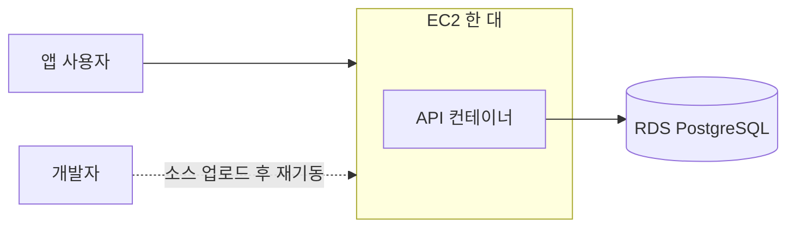
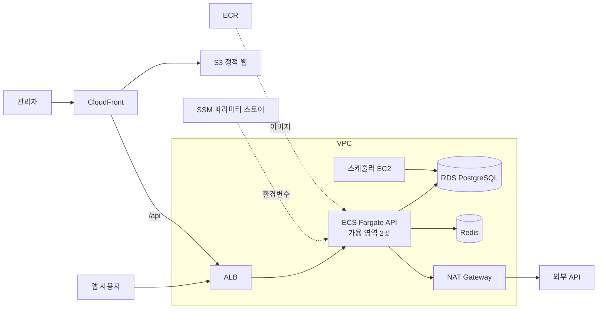

입사 당시 회사 서버에는 고가용성을 위한 구성이 없었다. API는 EC2 한 대에서 Docker 컨테이너로 실행됐고, 배포할 때마다 서버에 소스 코드를 올린 뒤 컨테이너를 재기동했다.

이 구조를 ECS 기반으로 바꾸면서 인프라 관리 도구로 Terraform을 도입하고, 인프라 코드 작업을 AI와 나눴다. 아래에는 도입 과정과 함께, Terraform으로 관리하면서 얻은 점과 감수한 점을 적었다.

## 기존 구성과 문제점



이 구성에는 네 가지 문제가 있었다.

| 문제 | 영향 |
| --- | --- |
| EC2가 한 대뿐이다 | 서버에 장애가 나면 서비스 전체가 중단된다 |
| 배포 시 컨테이너를 재기동한다 | 재기동하는 동안 요청을 처리하지 못한다 |
| 서버에서 직접 빌드한다 | 이전 버전 이미지가 남지 않아 롤백이 어렵다 |
| 리소스를 콘솔에서 만들었다 | 설정 내용과 변경 이유를 코드로 확인할 수 없다 |

앞의 세 가지는 로드밸런서(ALB), 컨테이너 실행 서비스(ECS), 이미지 저장소(ECR)를 도입하면 해결할 수 있다.

다만 이를 위해서는 프라이빗 서브넷, NAT Gateway, 보안 그룹, 대상 그룹, 리스너 규칙, 인증서, IAM 역할을 새로 만들어야 한다. 이 리소스들을 다시 콘솔에서 만들면 네 번째 문제는 그대로 남는다. 그래서 새 인프라는 코드로 관리하기로 했다.

## 인프라를 코드와 AI로 관리하기로 한 이유

이전 회사에서는 인프라가 계속 늘어났다. 설정은 거의 같고 이름만 다른 리소스를 여러 개 만드는 일이 많았다. 사람이 손으로 만들다 보니 중간중간 설정이 조금씩 어긋난 리소스가 생겼다.

인프라 규모가 커질수록 유지보수에 드는 시간도 늘었다. 그래서 이번에는 새 인프라를 만들기 전에 기존 인프라부터 코드로 옮기고, 그 작업을 AI와 나누기로 했다.

인프라는 Terraform 코드로 정의하고, 작성과 검수는 AI에, 적용 여부 결정은 사람에게 맡겼다.

| 역할 | 담당 |
| --- | --- |
| 코드 작성 | Claude Code |
| 코드 검수 | Codex |
| 적용 여부 결정 | 사람 (`plan` 결과 확인 후) |

AI가 인프라를 잘못 바꾸지 않도록 저장소의 에이전트 작업 규칙에 다음 내용을 넣었다.

- 작업 전후로 `terraform validate`로 설정 문법을 검사하고, `plan`으로 코드와 상태 파일(state), 실제 리소스가 일치하는지 확인한다.
- `plan`에 EC2 삭제나 교체가 포함되면 적용을 멈추고 별도 승인을 받는다.
- `apply` 승인을 EC2 삭제 승인으로 넓혀 해석하지 않는다.

실제 작업에서는 기존 리소스를 코드로 편입하는 import와, 적용 전에 변경 내용을 보여 주는 `plan`을 가장 많이 사용했다.

## 기존 리소스 편입

처음에는 새 리소스를 만들지 않았다. 운영 중인 VPC, 서브넷, 라우팅 테이블, RDS, ALB를 Terraform state로 가져오는 일부터 했다. 이 단계에서는 다음 원칙을 지켰다.

- `terraform apply`는 실행하지 않는다.
- `plan` 결과가 "변경 없음"이 될 때까지 코드를 실제 설정에 맞춘다.
- 개발 계정에서 먼저 검증한 뒤 같은 방식으로 운영 계정에 적용한다.

기존 EC2 인스턴스들은 상태 추적 목적으로만 편입했다. Terraform이 이 인스턴스를 수정하거나 삭제하지 않도록 아래처럼 설정했다.

```hcl
resource "aws_instance" "current" {
  for_each = var.current_instances
  # ...

  lifecycle {
    prevent_destroy = true
    ignore_changes  = all
  }
}
```

개발과 운영은 서로 다른 AWS 계정을 사용한다. 프로필을 잘못 선택해 다른 계정에 적용하는 사고를 막아야 했다. 그래서 공급자(provider) 설정에 `allowed_account_ids`를 지정했다. 계정이 일치하지 않으면 Terraform이 실행 전에 중단된다.

```hcl
provider "aws" {
  region              = var.aws_region
  profile             = var.aws_profile
  allowed_account_ids = [var.allowed_account_id]
}
```

반면 모든 리소스에 공통 태그를 붙이는 `default_tags`는 사용하지 않았다. 이 기능을 켜면 편입한 기존 리소스 전체에 태그 변경 계획이 생기므로, 편입 단계에서 실제 변경 사항을 구분하기 어려워진다.

## 현재 구성

편입을 마친 뒤 기존 VPC를 유지하면서 그 위에 새 구성을 추가했다.



관리자 웹은 CloudFront의 `/api` 경로를 통해 같은 ALB로 API를 호출한다. 스케줄러는 ECS가 아니라 별도 EC2에서 실행한다.

| 항목 | 이전 | 현재 |
| --- | --- | --- |
| API 실행 | EC2 한 대의 Docker 컨테이너 | ECS Fargate (가용 영역 2곳의 프라이빗 서브넷에 배치 가능) |
| 트래픽 분배 | 없음 | ALB가 헬스체크를 통과한 태스크로만 요청 전달 |
| 이미지 | 서버에서 직접 빌드 | ECR에 저장, 운영 이미지 최근 20개 보관 |
| 관리자 웹 | 별도 EC2에서 실행 | S3와 CloudFront로 정적 호스팅 |
| 환경변수 | 서버에 직접 설정 | AWS Systems Manager 파라미터 스토어(SSM) |

환경변수는 SSM에 저장한다. Terraform 코드에는 파라미터 경로만 두고, 파라미터 자체는 Terraform 리소스로 만들지 않았다. 그래서 비밀값이 state 파일에 남지 않는다.

배포 방식도 바뀌었다. ECS 롤링 배포의 기본 설정은 최소 정상 비율 100%, 최대 200%다. 새 태스크가 헬스체크를 통과한 다음 기존 태스크가 종료되므로, 재기동 방식처럼 요청을 처리하지 못하는 구간이 생기지 않는다.

## 고가용성 현황

현재 구성이 고가용성을 모두 갖춘 것은 아니다.

| 구성 요소 | 현재 상태 |
| --- | --- |
| API 실행 위치 | 가용 영역 2곳에 배치 가능 |
| API 태스크 수 | 1개 (배포 워크플로의 기본값) |
| DB | RDS 단일 가용 영역 (Multi-AZ 미사용) |
| Redis | 단일 노드 |
| NAT Gateway | 1개 |
| 스케줄러 | EC2 1대 |
| 배포 실패 시 자동 롤백 | API 서비스에는 미적용 |

NAT Gateway는 하나만 두었다. 운영 계정의 탄력적 IP(EIP) 한도에 여유가 없었고, 외부 API에 등록할 출발지 IP를 하나로 고정해야 했기 때문이다. 그 대신 NAT Gateway가 있는 가용 영역에 장애가 나면 다른 가용 영역의 태스크도 외부와 통신할 수 없다.

API 태스크, RDS, Redis를 이중화하지 않은 이유는 비용과 트래픽이다. 서비스 초기라 트래픽이 많지 않았고, 이중화로 늘어나는 월 비용에 비해 얻는 효과가 작다고 판단했다.

RDS Multi-AZ도 같은 이유로 미뤘다. 당시 나는 입사한 지 한 달 정도 된 상태였다. 인프라 구조를 바꾸는 작업에 더해 월 결제 비용까지 늘리는 결정을 바로 내리기는 어려웠다.

Redis는 이전 회사에서 클러스터 모드로 운영해 본 적이 있다. 클러스터 모드에서는 키가 해시 슬롯 단위로 여러 노드에 나뉘어 저장된다. 그래서 여러 키를 한 번에 다루는 명령이나 키 검색을 할 때 신경 쓸 부분이 많았다.

지금은 캐시를 사용하는 기능이 많지 않아서, 이런 관리 부담을 감수할 이유가 없었다. 장애 대비용 복제본은 클러스터 모드 없이도 둘 수 있으므로, Redis를 쓰는 비중이 커지면 그때 함께 검토할 예정이다.

| 미룬 항목 | 미룬 이유 | 다시 검토할 시점 |
| --- | --- | --- |
| API 태스크 2개 이상 | 트래픽이 적어 태스크 1개로 충분 | 트래픽이 늘어날 때 |
| RDS Multi-AZ | 월 비용 증가 | 트래픽이 늘어날 때 |
| Redis 복제본·클러스터 | 캐시 사용 비중이 낮고, 클러스터는 관리 부담이 큼 | Redis 사용 비중이 커질 때 |

세 항목 모두 지금 비용을 아끼는 대신 장애 위험을 일부 감수하는 선택이다. 그래도 이전과 비교하면 확장 방법이 단순해졌다. 이전에는 서버를 두 대로 늘리려면 구조를 다시 설계해야 했지만, 지금은 배포 워크플로에서 태스크 수만 바꾸면 된다. 나머지 항목도 Terraform 코드의 값을 바꾸고 `plan`으로 영향을 확인한 뒤 적용할 수 있다.

## Terraform으로 얻은 점

### 적용 전에 변경 내용을 확인할 수 있다

가장 큰 장점은 `plan`이었다. 정적 웹 리소스를 개별 블록에서 공통 맵 하나로 옮긴 적이 있다. 이 맵을 만든 과정은 [IAM 정책 6,144자 한도와 배포 역할 분리 기준](/posts/iam-jeongchaek-6144ja-handoe-makhyeo-baepo-yeokhaleul-nanwossda)에 정리했다.

이렇게 옮기면 리소스 주소가 바뀌고, Terraform은 기존 리소스를 삭제하고 새로 만드는 계획을 세운다. 그대로 적용하면 운영 중인 CloudFront와 S3가 다시 만들어진다.

그래서 `moved` 블록 52개로 주소만 변경하고, `plan`에서 추가·삭제·교체가 0건인 것을 확인한 뒤 적용했다. 이 재생성 위험은 Terraform으로 관리하면서 생긴 것이고, `plan` 덕분에 적용 전에 발견할 수 있었다.

### 리소스 관계와 변경 이유가 코드에 남는다

어떤 보안 그룹이 어떤 보안 그룹의 요청을 허용하는지, 리스너 규칙이 어느 대상 그룹으로 요청을 보내는지가 코드의 참조로 남는다. 인프라 변경도 PR로 올리므로, 변경 이유와 `plan` 결과가 커밋 기록에 함께 남는다.

## Terraform으로 감수한 점

ECS 태스크 정의와 실행 태스크 수는 Terraform이 아니라 배포 워크플로가 변경한다. 배포할 때마다 새 이미지로 태스크 정의가 갱신되기 때문이다. 그래서 Terraform에서는 두 값을 `ignore_changes`로 제외했다.

```hcl
lifecycle {
  ignore_changes = [
    desired_count,
    task_definition,
  ]
}
```

이 때문에 Terraform 코드만으로는 현재 실행 중인 태스크 수와 이미지 버전을 알 수 없다. 서비스를 처음 만들 때는 태스크 수를 0으로 두었다. 운영 트래픽을 보호하기 위해, 배포 워크플로가 첫 이미지를 올리고 태스크 수를 정하기 전까지 태스크를 띄우지 않는 설정이다.

## 얻은 점과 감수한 점 비교

| 얻은 점 | 감수한 점 |
| --- | --- |
| 적용 전에 `plan`으로 영향 확인 | 배포 워크플로와 관리 범위가 나뉨 |
| 리소스 관계와 변경 이유가 코드에 남음 | 편입이 끝날 때까지 `default_tags`를 미룸 |

## 정리

- 운영 중인 인프라에 Terraform을 도입하면서 가장 먼저 한 일은 기존 리소스 import였다. `plan`이 "변경 없음"을 낼 때까지 코드를 실제 설정에 맞췄다.
- 이전 회사에서 비슷한 리소스를 손으로 만들다 설정이 조금씩 어긋나는 일을 겪었다. 이번에는 인프라를 Terraform 코드로 관리하고, 코드 작성은 Claude Code, 검수는 Codex에 맡겼다. 적용 여부는 사람이 `plan` 결과를 보고 결정한다.
- EC2에서 ECS로 옮겼지만 고가용성을 모두 갖추지는 않았다. 트래픽과 비용을 고려해 태스크 이중화, RDS Multi-AZ, Redis 복제본은 필요해지면 다시 검토하기로 했다.
- Terraform으로 관리하면서 배포 워크플로와 관리 범위가 나뉘었다. 배포 워크플로가 바꾸는 값은 Terraform 코드만으로 확인할 수 없다.