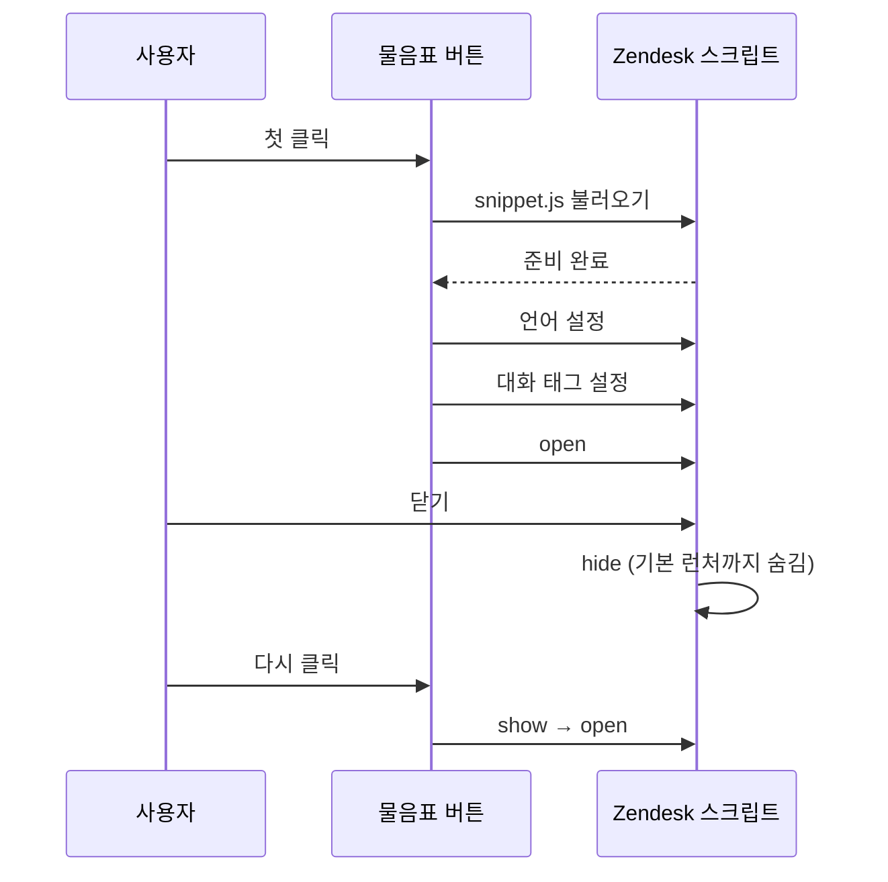
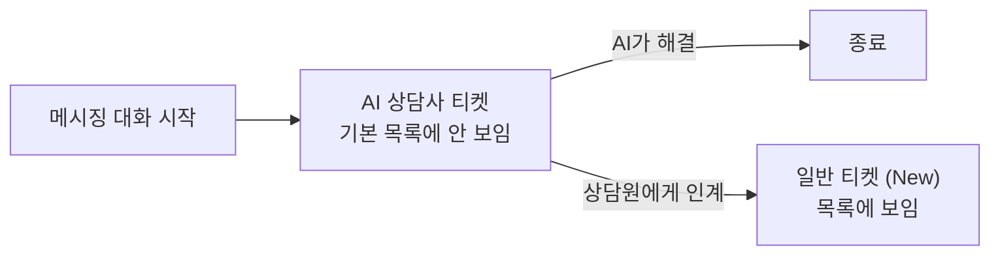

회사 웹 서비스의 "?" 버튼은 원래 앱 딥링크로 고객센터 화면을 열었다. 앱이 없는 웹 사용자에게는 쓸모가 없었다. 그래서 웹에서 바로 상담 창이 열리도록 Zendesk 웹 위젯을 붙이기로 했다.

작업 도중 Zendesk 쪽 설정이 바뀌었다. 웹 위젯이 기존 방식인 '클래식'에서 대화형 방식인 '메시징'으로 전환됐다. AI 상담사가 먼저 응답하도록 구성도 바뀌었다.

이 글은 메시징 위젯을 Next.js에 붙인 방법과, 배포 후 시험 문의가 상담원 목록에 보이지 않은 이유를 정리한 기록이다.

## 메시징 API 전용 구성

처음 계획에는 클래식과 메시징을 설정값으로 고르는 전환 스위치가 있었다. 그런데 이미 메시징으로 전환했고 돌아갈 계획이 없었다.

쓰지 않는 분기는 검증도 할 수 없다. 그래서 메시징 API만 쓰기로 하고 클래식 어댑터는 뺐다. 나중에 클래식으로 돌아가더라도 호출부 한 파일만 고치면 된다.

쓰는 호출은 이 정도였다. 태그 이름은 예시로 바꿔 적었다.

```ts
zE("messenger:set", "locale", lang === "ko" ? "ko" : "en-US");
zE("messenger:set", "conversationTags", ["web-service"]);
zE("messenger", "open");
zE("messenger", "show");
zE("messenger", "hide");
zE("messenger:on", "close", () => zE("messenger", "hide"));
```

## 첫 클릭 시점의 스크립트 로딩

위젯 스크립트는 "?"를 처음 누를 때 불러오게 했다. 대부분의 방문자는 상담 창을 열지 않으므로, 이들까지 위젯 스크립트를 미리 받을 이유가 없다.



- 언어와 태그는 열기 전에 설정한다. 태그는 대화가 시작될 때 티켓에 붙는다. 위젯에서 나중에 설정한 태그는 이미 만들어진 티켓에 붙지 않는다.
- 닫으면 `hide`로 기본 버튼까지 숨긴다. 우리 "?" 버튼과 Zendesk 기본 런처가 화면에 둘 다 떠 있으면 헷갈린다.
- 키가 없거나 스크립트를 못 불러오면 기존 딥링크로 연다. 위젯 장애가 고객센터 진입 자체를 막으면 안 된다.

## 빌드 인자로 넘긴 위젯 키

위젯 키는 `NEXT_PUBLIC_` 환경변수라 빌드할 때 코드에 그대로 박힌다. 컨테이너를 실행할 때 넣으면 반영되지 않으므로, Docker 이미지를 빌드할 때 인자로 넘겼다.

```dockerfile
ARG NEXT_PUBLIC_ZENDESK_WIDGET_KEY
ENV NEXT_PUBLIC_ZENDESK_WIDGET_KEY=$NEXT_PUBLIC_ZENDESK_WIDGET_KEY
```

GitHub Actions 변수에 키를 두고, 배포 워크플로의 `--build-arg`로 넘긴다.

## 목록에 보이지 않은 시험 문의

배포 후 운영 사이트에서 상담 창을 열고 시험 문의를 하나 보냈다. AI 상담사가 문의를 확인했다고 답했다. Zendesk 검색 API로 보니 티켓도 만들어졌고 태그도 붙어 있었다.

그런데 상담원 화면의 티켓 목록에는 없었다. 조건에 맞는 티켓을 모아 보여 주는 '보기(view)' 중 활성 상태인 6개를 하나씩 조회해도 없었다. 직접 주소로 열면 보였다.

보기 조건을 보니 `support_type is 0`이라는 조건이 있었다. 이 조건이 AI 상담사가 처리 중인 대화를 걸러내는 것으로 보였다. 0이 정확히 '일반 티켓'을 뜻하는지는 공식 문서에서 직접 확인하지 못했다. 동작이 맞아서 그렇게 판단했다.

[Zendesk 공식 문서](https://support.zendesk.com/hc/en-us/articles/9204149016346-Understanding-AI-agent-tickets-for-AI-agent-only-conversations)에서 나머지 답을 찾았다.

- AI 상담사가 혼자 처리 중인 메시징 대화는 'AI 상담사 티켓'이라는 별도 종류로 만들어진다.
- 이 티켓은 상담원 홈과 기본 목록에 나오지 않는다. API 목록 조회도 기본값에서는 빠지고, `support_type_scope=ai_agent`를 붙여야 나온다.
- AI 상담사가 상담원에게 넘기면 일반 티켓으로 바뀌고, 그때 목록에 나온다.



연동에는 문제가 없었다. AI 상담사가 답하는 동안의 문의는 원래 기본 목록에서 빠진다.

## 운영팀에 알려야 할 것

이 동작을 모르면 "웹 문의가 안 들어온다"고 오해하기 쉬워서 확인 방법을 정리해 두었다.

AI 상담사 티켓은 직접 주소로 열거나 보기 조건을 바꿔서 볼 수 있다. 웹에서 들어온 문의만 모아 보려면 "태그 포함" 조건의 보기를 하나 만들면 된다.

## 정리

- 쓰지 않는 분기(클래식 위젯)는 검증할 수 없으므로 남기지 않는다.
- 위젯 스크립트는 처음 누를 때 불러오고, 설정은 열기 전에 끝낸다.
- 위젯이 실패해도 기존 딥링크로 고객센터에 들어갈 수 있어야 한다.
- 연동이 끝났는데 데이터가 안 보이면, 먼저 "보는 쪽의 필터"를 의심한다. 이번에는 목록 보기의 조건이 원인이었다.