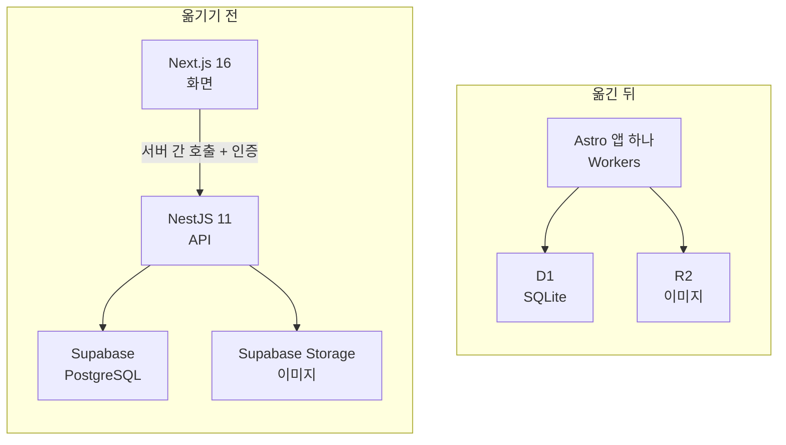
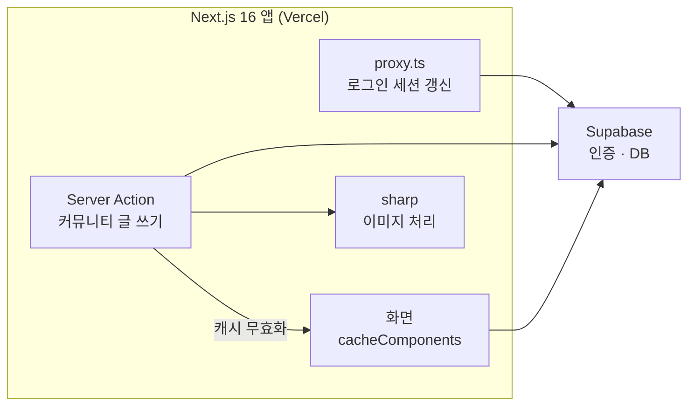

개인 프로젝트로 게임 정보 사이트를 운영하고 있다. 운 좋게 트래픽이 많이 들어왔지만, 수익보다 서버 비용이 먼저 쌓였다.

이 일을 겪고 나서 새로 만드는 서비스는 처음부터 Cloudflare로 시작하기로 했다. 이 블로그도 Vercel에서 Cloudflare로 옮겼다. 그렇게 정한 이유와, 게임 정보 사이트는 아직 옮기지 않은 이유를 정리한다.

## 게임 정보 사이트에서 먼저 쌓인 비용

게임 정보 사이트는 Vercel과 Supabase 위에서 돌아간다. 사이트를 연 뒤 트래픽이 예상보다 많이 들어와서, 방문자를 보려고 분석 도구도 이것저것 붙였다.


다음 단계는 광고였다. 그런데 구글 애드센스나 다른 광고를 붙이는 일이 생각보다 쉽지 않았다.

트래픽이 수익을 바로 만들어 주지는 않았다. 그사이에도 서버와 데이터베이스(DB) 유지비는 매달 10만 원 이상 나가고 있어서, 수익이 생기기 전에 고정비가 먼저 쌓이는 구조였다.

## 새 서비스는 처음부터 Cloudflare로

최근 한 달 사이에 웹사이트 5개를 만들었다. 그중 Next.js로 만들어 Vercel과 Supabase에 올린 것은 가장 먼저 만든 게임 정보 사이트 하나다.

나머지 4개는 이 사이트의 유지비를 교훈으로 삼아 처음부터 Cloudflare로 시작했다. 수익이 생기기 전까지 고정비를 적게 두려는 것이다.

| 사이트 | 플랫폼 | 상태 |
|---|---|---|
| 게임 정보 사이트 | Vercel + Supabase(Next.js) | 운영 중, 아직 수익 없음 |
| 사이트 2개 | Cloudflare | 운영 중, 아직 수익 없음 |
| 사이트 2개 | Cloudflare | 시간이 없어 작업을 멈춤 |

고정비를 적게 둘 수 있는 것은 Cloudflare Workers의 유료 플랜이 계정 단위 구독이기 때문이다. 사이트를 하나 더 올려도 서버와 DB를 한 벌씩 새로 빌리지 않으므로, 수익이 없는 사이트가 늘어나도 사이트마다 고정비가 따로 붙지 않는다.


## 이 블로그를 옮긴 구성

이 블로그도 같은 이유로 옮겼다. 원래는 Vercel과 Supabase 위에 있었고, 목표는 두 서비스의 유료 요금을 없애는 것이었다. 옮긴 뒤에는 블로그가 쓰던 Vercel과 Supabase를 둘 다 해지했다.



예전에는 앱이 두 개였다. Next.js 화면이 NestJS API를 서버끼리 호출했기 때문에, 그 호출을 인증하는 코드도 따로 있었다.

Astro 앱 하나로 합치면서 NestJS와 서버 간 인증이 함께 없어졌다. 지금은 Workers(Cloudflare의 서버리스 실행 환경)에서 도는 이 앱이 D1(SQLite 기반 DB)과 R2(파일 저장소)를 쓴다.

### 글 본문 렌더링을 다시 만들었다

글 본문은 DB에 MDX 문자열로 저장돼 있다. 예전에는 `next-mdx-remote`의 `compileMDX`로 요청마다 본문을 그렸다. 이 방식은 Workers에서 그대로 쓸 수 없었다.

`compileMDX`는 MDX를 JavaScript로 컴파일한 뒤 실행하는데, Workers는 보안상 `eval`과 `new Function`을 막는다. `next-mdx-remote` 저장소도 이미 보관(archived)되어 더 이상 관리되지 않는다.

그래서 본문을 실행하지 않고 파싱만 해서 HTML로 바꾸게 했다. 공개된 글 21편을 확인해 보니 실행이 필요한 문법은 없었고, 본문에 쓴 컴포넌트도 X 게시물을 넣는 `XEmbed` 하나뿐이었다.

```text
remark-parse → remark-mdx → remark-gfm → Mermaid 처리 → remark-rehype → 컴포넌트 처리(XEmbed) → rehype-stringify
```

### 이미지는 원본을 그대로 쓴다

예전에는 Vercel에서 Next.js의 `next/image`가 이미지 크기를 줄여 줬다. 지금은 커버 이미지를 R2에 두고 원본을 그대로 보여 주는데, 커버가 이미 평균 126KB 정도의 webp라서 따로 줄일 필요가 적었다.

Astro의 Cloudflare 어댑터(`@astrojs/cloudflare`)는 기본값으로 Cloudflare Images 연결을 만든다. 이 연결은 무료 사용량을 넘으면 요금이 붙을 수 있어서, `imageService: 'passthrough'`로 끄고 원본을 내보낸다.

## Next.js를 Cloudflare에 그대로 올리지 않은 이유

Next.js 앱을 Cloudflare Workers에서 돌리려면 OpenNext의 Cloudflare 어댑터(`@opennextjs/cloudflare`)를 쓰는 방법도 있다. 이 어댑터가 Next.js 빌드 결과를 Workers에서 실행할 수 있게 바꿔 준다.

다만 내가 문서로 확인한 범위에서는 아직 호환성이 좋지 않아 보였다. 특히 걸린 부분은 캐시와 sharp다.

| 부분 | 걸린 점 |
|---|---|
| 캐시 | Next.js 캐시를 쓰려면 R2나 KV 같은 저장소를 따로 연결하고 설정해야 한다 |
| sharp | 네이티브 바이너리를 쓰는 라이브러리라 Workers에서 돌지 않는다. `next/image`는 Cloudflare Images로 대신 처리한다 |

둘 다 Vercel에서는 신경 쓰지 않던 설정과 비용이다.

블로그는 어차피 본문 렌더링을 다시 만들어야 했고, NestJS를 없애 앱을 하나로 줄이는 것도 목표였다. 그래서 OpenNext로 옮기는 대신 Astro로 다시 쓰는 쪽을 골랐다.

## 게임 정보 사이트는 지금 옮기지 않는다

비용이 가장 많이 나가는 곳은 게임 정보 사이트다. 그래도 이 사이트는 지금 옮기지 않기로 했다.

이 사이트는 Vercel 위의 Next.js 16 앱이고, 로그인과 DB는 Supabase를 쓰지만, 화면 대부분은 Next.js 기능 위에 올라가 있다.



Next.js에 기대는 부분을 정리하면 이렇다.

- 화면 캐시: `cacheComponents`를 켜고 `use cache`와 `cacheLife`로 화면마다 캐시 시간을 정했다. 7개 파일이 이 방식을 쓴다.
- 캐시 무효화: 커뮤니티 글은 Server Action(서버에서 실행되는 폼 처리 함수)으로 저장한다. 저장한 뒤 `updateTag`·`revalidateTag`로 관련 화면 캐시를 지운다.
- 이미지 처리: 업로드 이미지 크기를 줄일 때와 링크 미리보기 이미지(OG 이미지)를 만들 때 sharp를 쓴다.
- 로그인: `proxy.ts`(Next.js 16에서 미들웨어가 바뀐 이름)가 로그인이 필요한 화면에서만 Supabase 세션을 갱신한다.

앞에서 OpenNext로 옮길 때 걸린다고 본 캐시와 sharp가 이 사이트에서는 핵심 기능이다. 특히 이 사이트는 `next/image` 최적화를 끄고 서버 코드에서 sharp를 직접 부른다. 그래서 `next/image`를 Cloudflare Images로 대신하는 것만으로는 해결되지 않는다.

그대로 옮기기는 어렵고, 제대로 옮기려면 블로그처럼 Astro로 전부 다시 써야 할 수도 있다.

마침 지금 광고 제휴가 들어와 있다. 트래픽이 몰리는 사이트를 다시 쓰다가 문제가 생기면 제휴에도 영향을 준다. 그래서 옮기는 작업은 광고 제휴 일을 먼저 끝낸 뒤로 미뤘다.

| 구분 | 블로그 | 게임 정보 사이트 |
|---|---|---|
| Next.js 기능 의존 | 작다(본문 렌더링은 어차피 다시 만들어야 했다) | 크다(캐시·sharp·proxy.ts) |
| 옮기는 방법 | Astro로 다시 씀 | Astro로 전부 다시 써야 할 수도 있다 |
| 지금 우선순위 | 유지비 정리 | 광고 제휴 |
| 결정 | 옮김 | 미룸 |

## 정리

- 트래픽이 많다고 수익이 바로 생기지는 않는다. 그동안에도 서버와 DB 비용은 매달 나간다.
- 새 서비스는 처음부터 Cloudflare로 시작한다. 수익이 없는 사이트가 늘어나도 고정비가 크게 늘지 않게 하려는 것이다.
- 이 블로그는 Next.js + NestJS를 Astro 앱 하나로 합치고 D1·R2로 옮겼다.
- 블로그는 본문 렌더링을 어차피 다시 만들어야 했고 앱도 하나로 줄이고 싶어서, OpenNext 대신 Astro로 다시 썼다.
- 이미 Next.js 의존이 큰 서비스는 옮기는 위험과 지금 할 일을 함께 보고 시점을 정한다. 게임 정보 사이트는 광고 제휴가 먼저다.
